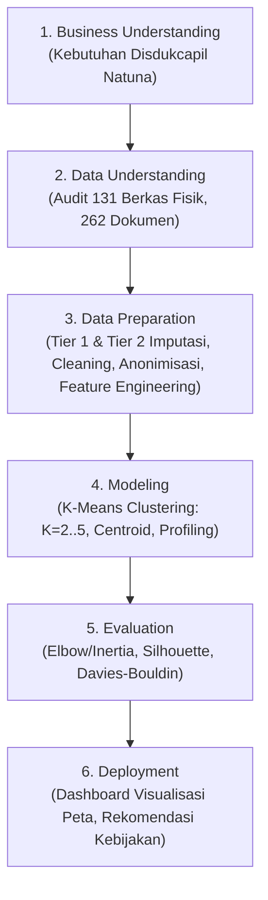

# MASTER RESEARCH MEMORY: PROYEK PENAMBANGAN DATA PD-NTN25
**KONSOLIDASI KOMPREHENSIF: MEMORI RISET V4 + V5 + ADDENDUM V6**

---

## 1. IDENTITAS PENELITIAN & KONTEKS BISNIS (BUSINESS UNDERSTANDING)

### A. Profil Proyek
* **Judul Proyek:** Pengelompokkan Wilayah dan Analisis Keterlambatan Pencatatan Akta Kelahiran Menggunakan Algoritma K-Means Clustering pada DISDUKCAPIL Kabupaten Natuna.
* **Tahun Akademik:** Semester Ganjil 2026/2027.
* **Institusi Mitra:** Dinas Kependudukan dan Pencatatan Sipil (DISDUKCAPIL) Kabupaten Natuna, Provinsi Kepulauan Riau.
* **Narasumber Teknis:** Ibu Julida, S.Sos (Administrator Database Kependudukan / Pelayanan Pendaftaran Penduduk DISDUKCAPIL Kabupaten Natuna).

### B. Tim Peneliti Mahasiswa
1. **Ridho Ramadani E (Ketua)** — NIM: 2401020121
2. **Salma Nursafira** — NIM: 2401020094
3. **Monalisa Dwi Cantika** — NIM: 2401020100
4. **Sarah Fauziyyah** — NIM: 2401020109
5. **Muhammad Agus Farhan** — NIM: 2401020111

### C. Landasan Hukum & Regulasi
1. **UU No. 24 Tahun 2013 tentang Perubahan atas UU No. 23 Tahun 2006 tentang Administrasi Kependudukan:**
   * Kelahiran wajib dilaporkan paling lambat **60 (enam puluh) hari** sejak tanggal persalinan.
   * **Lahir Umum (LU):** Pelaporan $\le 60$ hari sejak tanggal kelahiran.
   * **Lahir Terlambat (LT):** Pelaporan $> 60$ hari sejak tanggal kelahiran (memerlukan prosedur tambahan / verifikasi khusus).
2. **UU No. 27 Tahun 2022 tentang Pelindungan Data Pribadi (UU PDP):**
   * Kewajiban anonimisasi atribut identitas pribadi (*Personally Identifiable Information / PII*) seperti NIK, Nama Lengkap, Nomor KK sebelum publikasi atau pemodelan terbuka.

### D. Konteks Geografis & Masalah Riset
* **Tantangan Geografis:** Kabupaten Natuna merupakan wilayah kepulauan terluar di Laut Natuna Utara dengan disparitas akses transportasi antarpulau, ketergantungan pada cuaca laut, dan rentang kendali ke ibu kota kabupaten (Ranai).
* **Masalah:** Disdukcapil membutuhkan dasar ilmiah berbasis data (*data-driven decision making*) untuk mengidentifikasi kantong-kantong wilayah dengan tingkat keterlambatan pelaporan tinggi (*High-Delay*) vs kepatuhan tinggi (*High-Compliance*) agar program sosialisasi, jemput bola (pelayanan keliling), dan alokasi sumber daya dapat terarah secara presisi.

---

## 2. LANDASAN METODOLOGI RISET (CRISP-DM FRAMEWORK)

Penelitian ini mengikuti 6 tahapan baku standar industri **CRISP-DM (Cross-Industry Standard Process for Data Mining)**:



---

## 3. REKAPITULASI STATUS DATA & AUDIT QA/QC (V4 + V5)

### A. Repositori Data Fisik dan Digital
1. **Data Mentah Asli (Raw Image Archive):**
   * Terdapat 131 folder berkas (`1` s.d. `131`) berisi 262 pindaian fisik dokumen pendaftaran akta kelahiran:
     * Formulir Pelaporan Pencatatan Kelahiran (F-2.01)
     * Surat Keterangan Lahir (SKL Medis Faskes / Bidan) atau Surat Pernyataan Tanggung Jawab Mutlak (SPTJM Kebenaran Kelahiran).
2. **Data Backup Murni (100% Raw Untouched):**
   * Berkas: [Copy of Template_Data_Mentah_Akta_Kelahiran_BACKUP_RAW.xlsx](file:///home/wh4mi/Dokumen/S5/jumat/data_mining/projek/DISDUKCAPIL_NTN/PD-NTN25/DATA_CLEAN/Copy%20of%20Template_Data_Mentah_Akta_Kelahiran_BACKUP_RAW.xlsx) (131 baris entri orisinal).
3. **Arsip Ekstraksi JSON (Chunk Chunks):**
   * Disimpan terisolasi di folder [DATA_CLEAN/DATA_EXTRAKSI_CHUNKS/](file:///home/wh4mi/Dokumen/S5/jumat/data_mining/projek/DISDUKCAPIL_NTN/PD-NTN25/DATA_CLEAN/DATA_EXTRAKSI_CHUNKS/) (arsip transkripsi digital 131 entri berkas pemohon).
4. **Dataset Bersih & Terpadu (Final Clean & Factual Imputed):**
   * Berkas Utama: [Data_Bersih_Akta_Kelahiran_Lengkap_Imputed.xlsx](file:///home/wh4mi/Dokumen/S5/jumat/data_mining/projek/DISDUKCAPIL_NTN/PD-NTN25/DATA_CLEAN/Data_Bersih_Akta_Kelahiran_Lengkap_Imputed.xlsx)
   * Berkas Sinkronisasi: [Data_Mentah_Transkripsi_Akta_Kelahiran_2025.xlsx](file:///home/wh4mi/Dokumen/S5/jumat/data_mining/projek/DISDUKCAPIL_NTN/PD-NTN25-FINAL/02_DATA_UNDERSTANDING/02_tabulasi_transkripsi/Data_Mentah_Transkripsi_Akta_Kelahiran_2025.xlsx)

### B. Protokol QA/QC: Kebijakan Non-Rekayasa (Zero Fabrication)
1. **Tier 1 (Sinkronisasi Silang Antar-Sheet Berbasis Bukti Otentik):**
   * `Tempat_Kelahiran` (FP) dilengkapi dari `Tempat_Lahir` (SK).
   * `Kelahiran_Ke` (FP) $\leftrightarrow$ `Anak_Ke` (SK) saling melengkapi secara faktual.
   * `Waktu_Lahir` (Jam) saling melengkapi jika tercatat pada salah satu dokumen.
   * `Tanggal_Pelaporan` (FP) $\leftrightarrow$ `Tanggal_Penerbitan_Surat` (SK) saling melengkapi tanggal administrasi.
   * `Nama_Saksi_I` & `Nama_Saksi_II` saling melengkapi data saksi.
2. **Tier 2 (Klasifikasi Faktual Faskes & Penolong Medis):**
   * `Tempat_Dilahirkan`: Ditetapkan secara deterministik dari instansi penerbit resmi SKL (`RS/RB`, `PUSKESMAS`, `POLINDES`/BPM, `RUMAH`/SPTJM).
   * `Penolong_Kelahiran`: Ditetapkan dari gelar/profesi penandatangan resmi SKL (`DOKTER`, `BIDAN/PERAWAT`, `DUKUN`).
3. **Kelengkapan Administrasi Wilayah (100% Faktual):**
   * `Kecamatan`, `Desa_Kelurahan`, `Kode_Wilayah` (10 digit standar Kemendagri wilayah Kabupaten Natuna), dan `Kewarganegaraan` (`INDONESIA`) telah terverifikasi 131/131 baris (100% lengkap).
4. **Tier 4 (Kolom Asli yang Dipertahankan Kosong):**
   * `Pekerjaan_Ayah`, `Pekerjaan_Ibu`, `Berat_Bayi_Kg`, `Panjang_Bayi_Cm`, dan `Nomor_Surat` (pada 50 dokumen SPTJM) **100% dipertahankan kosong apa adanya** karena pada berkas fisik aslinya memang tidak tercantum. Tidak ada rekayasa data sintetik.
5. **Laporan Audit QA/QC Resmi:**
   * Terdokumentasi lengkap pada [audit_qa_qc_final.md](file:///home/wh4mi/.gemini/antigravity/brain/ad1dae52-bc85-4c7a-9967-38dbe31605d4/audit_qa_qc_final.md) dengan status **PASSED (100% Faktual, Terverifikasi, & Siap Data Mining)**.

---

## 4. ADDENDUM V6 — STANDAR DOKUMENTASI KODE PYTHON, EXPLAINABILITY, DAN KESIAPAN PRESENTASI

Ketentuan ini bersifat mutlak dan mengikat seluruh aktivitas penulisan, modifikasi, eksekusi, serta pelaporan kode Python dalam proyek riset PD-NTN25.

### 4.1. Prinsip Utama: Kode Python Harus Bisa Dipahami Manusia
Setiap kode Python tidak boleh diposisikan sebagai "black-box" yang hanya menghasilkan angka atau plot tanpa pemahaman logika. Setiap anggota kelompok mahasiswa wajib memahami:
* Apa yang dilakukan kode.
* Mengapa kode tersebut digunakan.
* Data apa yang menjadi input.
* Bagaimana input diproses langkah demi langkah.
* Algoritma atau metode matematika apa yang digunakan.
* Apa output yang dihasilkan dan bagaimana cara membacanya.
* Bagaimana output tersebut mengalir ke tahapan penelitian berikutnya.
* Bagaimana menjelaskan kode dan hasilnya saat ujian/presentasi di hadapan dosen.
* Apa keterbatasan, asumsi, atau risiko dari kode tersebut.

> **ATURAN MUTLAK:** Jangan pernah membuat kode Python yang hanya dapat dijalankan tetapi tidak dapat dijelaskan secara ilmiah oleh anggota kelompok.

---

### 4.2. Wajib Membuat Python Code Explanation Log
Setiap script (`.py`), notebook (`.ipynb`), atau pipeline Python wajib disertai berkas dokumentasi penjelasan teknis (`EXPLANATION_<NAMA_TAHAP>.md`) atau markdown cell terstruktur di dalam notebook.

Struktur folder terorganisasi sesuai tahapan CRISP-DM:
```text
PD-NTN25/
├── 03_DATA_PREPARATION/
│   ├── feature_engineering/
│   │   ├── feature_engineering.py
│   │   ├── feature_engineering.ipynb
│   │   ├── EXPLANATION_FEATURE_ENGINEERING.md
│   │   └── PRESENTATION_NOTES_FEATURE_ENGINEERING.md
│   ├── feature_selection/
│   │   ├── feature_selection.py
│   │   └── EXPLANATION_FEATURE_SELECTION.md
│   └── logs/
│       └── LOG_PREPROCESSING.md
│
├── 04_MODELING/
│   ├── kmeans/
│   │   ├── kmeans_model.py
│   │   ├── kmeans_experiment.ipynb
│   │   ├── EXPLANATION_KMEANS.md
│   │   └── PRESENTATION_NOTES_KMEANS.md
│   └── modeling_logs/
│       └── EXPERIMENT_RESULTS.md
```

---

### 4.3. Standar 7 Bagian Penjelasan Setiap Kode Python (A s.d. G)
Setiap modul kode wajib memiliki dokumentasi dengan anatomi standar berikut:

* **A. Identitas Kode:**
  * Nama file.
  * Tujuan script.
  * Tahapan CRISP-DM terkait.
  * Tanggal pembuatan/revisi dan versi.
* **B. Masalah yang Ingin Diselesaikan:**
  * Latar belakang perumusan masalah riset yang melandasi pembuatan kode (contoh: menghitung selisih hari antara tanggal kelahiran dan tanggal pelaporan untuk menentukan kepatuhan regulasi 60 hari UU No. 24/2013).
* **C. Penjelasan Input:**
  * Nama file input konkret, nama sheet/tabel.
  * Kolom-kolom yang digunakan dan tipe data aslinya.
  * Jumlah baris data yang diproses.
  * Kondisi missing values dan status validitas input.
* **D. Penjelasan Proses:**
  * Library Python yang digunakan (misal: `pandas`, `numpy`, `scikit-learn`) dan alasan pemilihannya.
  * Alur langkah eksekusi (baca data, validasi, transformasi, perhitungan rumus).
  * Rumus matematika atau formulasi algoritma.
  * Penanganan kondisi khusus / *edge cases* / *missing values*.
* **E. Penjelasan Output:**
  * Nama file output yang dihasilkan, format, sheet.
  * Kolom-kolom baru/hasil transformasi, jumlah baris.
  * Contoh output representatif (cuplikan 3–5 baris).
  * Makna fungsional data hasil olahan.
* **F. Validasi:**
  * Prosedur verifikasi kebenaran kerja kode:
    * Pemeriksaan kekekalan baris ($N_{in} = N_{out}$).
    * Pemeriksaan nilai negatif/tidak masuk akal (misal: usia $<0$ atau durasi pelaporan negatif).
    * Pemeriksaan missing values pada fitur luaran.
    * Pemeriksaan rentang nilai (*range checking*).
* **G. Kesimpulan:**
  * Rangkuman hasil yang diperoleh dan kontribusinya terhadap pencapaian tujuan penelitian.

---

### 4.4. Wajib Membuat Code Walkthrough Table
Untuk modul inti, wajib menyertakan tabel *walkthrough* per blok kode fungsional:

| Bagian | Kode / Operasi | Penjelasan Teknis | Tujuan Fungsional |
| :---: | :--- | :--- | :--- |
| **1** | `import pandas as pd`, `from sklearn...` | Memanggil library pengolah data dan machine learning | Menyiapkan dependensi lingkungan kerja |
| **2** | `pd.read_excel('Data_Bersih_...xlsx')` | Membaca dataset bersih hasil imputasi faktual | Mengakses data terverifikasi ke dalam memori DataFrame |
| **3** | `df['Tgl_Lahir'].isna().sum()` | Memeriksa ketiadaan data kosong pada kolom kunci | Menjamin data input valid sebelum operasi matematika |
| **4** | `(df['Tgl_Lapor'] - df['Tgl_Lahir']).dt.days` | Menghitung durasi keterlambatan pelaporan dalam hari | Membentuk fitur numerik utama kepatuhan (LU/LT) |
| **5** | `df.to_excel('Output_Feature_Engineered.xlsx')` | Menyimpan DataFrame terkayakan ke media penyimpanan | Menyiapkan dataset siap pakai untuk tahap seleksi fitur/modeling |

---

### 4.5. Python Input-Output Trace
Setiap script wajib memetakan aliran data konkret menggunakan nama file dan nama kolom nyata:

```text
[INPUT: Data_Bersih_Akta_Kelahiran_Lengkap_Imputed.xlsx]
  │  (Kolom: Tanggal_Lahir, Tanggal_Pelaporan, Tgl_Lahir_Ayah, Tgl_Lahir_Ibu)
  ▼
[Validasi Tipe Data & Rentang Kronologis]
  │  (Pastikan Tgl_Pelaporan >= Tgl_Lahir dan Tgl_Lahir_Ortu < Tgl_Lahir_Anak)
  ▼
[Transformasi & Feature Engineering]
  │  • Durasi_Pelaporan_Hari = Tanggal_Pelaporan - Tanggal_Lahir
  │  • Status_Kepatuhan = "LU" jika Durasi <= 60 hari else "LT"
  │  • Usia_Ayah_Saat_Lahir = Tahun_Lahir_Anak - Tahun_Lahir_Ayah (penyesuaian hari/bulan)
  │  • Usia_Ibu_Saat_Lahir = Tahun_Lahir_Anak - Tahun_Lahir_Ibu (penyesuaian hari/bulan)
  ▼
[Validasi Kewajaran Statistik]
  │  (Durasi >= 0, Usia Ortu antara 15 s.d. 70 tahun)
  ▼
[OUTPUT: Dataset_Feature_Engineered_PD_NTN.xlsx]
  │
  ▼
[Digunakan pada: 04_MODELING (K-Means Clustering)]
```

---

### 4.6. Wajib Membuat Python Presentation Explanation & Presentation Log
Untuk memudahkan mahasiswa saat presentasi sidang/evaluasi proyek, setiap modul kode penting harus dilengkapi berkas `PRESENTATION_NOTES_<NAMA_MODUL>.md` yang memuat:

#### A. Penjelasan Bahasa Sederhana (Untuk Mahasiswa)
Penjelasan intuitif dengan analogi praktis tanpa jargon membingungkan, menjelaskan apa yang dilakukan kode dalam waktu 1–2 menit.

#### B. Penjelasan Akademik / Ilmiah
Penjelasan formal berbasis teori data science, metodologi CRISP-DM, persamaan matematis, dan justifikasi ilmiah pemilihan algoritma.

#### C. Matriks Kesiapan Tanya-Jawab Dosen (Lecturer Q&A Defense Prep)
1. **Pertanyaan tentang INPUT:**
   * *Contoh Dosen:* "Mengapa data tanggal yang digunakan diambil dari FP dan SK, bagaimana jika keduanya berbeda?"
   * *Jawaban Terstruktur:* Jelaskan hierarki pembuktian Tier 1, di mana SKL faskes menjadi acuan medis waktu lahir, sedangkan FP menjadi bukti pendaftaran resmi pemohon di Disdukcapil.
2. **Pertanyaan tentang PROSES:**
   * *Contoh Dosen:* "Mengapa data numerik wajib diskalakan (`StandardScaler`) sebelum K-Means?"
   * *Jawaban Terstruktur:* K-Means menghitung jarak Euclidean ($\sqrt{\sum (x_i - y_i)^2}$). Jika variabel `Durasi_Pelaporan` (rentang 0–3000 hari) tidak diskalakan, variabel tersebut akan mendominasi perhitungan jarak dibanding variabel `Usia_Ibu` (rentang 18–45 tahun). Scaling membawa semua fitur ke mean 0 dan varians 1.
   * *Contoh Dosen:* "Bagaimana menentukan nilai optimal $K$?"
   * *Jawaban Terstruktur:* Mengombinasikan Elbow Method (mencari titik tekuk penurunan *Inertia* / WCSS) dan analisis *Silhouette Score* (mengukur kohesi intra-cluster vs separasi inter-cluster) serta nilai *Davies-Bouldin Index*.
3. **Pertanyaan tentang OUTPUT & INTERPRETASI:**
   * *Contoh Dosen:* "Apa arti dari centroid cluster 0, 1, dan 2?"
   * *Jawaban Terstruktur:* Menjelaskan profil karakteristik rata-rata tiap cluster (misal: Cluster High-Compliance = durasi rata-rata 12 hari, persentase LU 95%; Cluster High-Delay = durasi rata-rata 480 hari, dominan SPTJM dan wilayah pulau terpencil).
4. **Pertanyaan tentang KETERBATASAN:**
   * *Contoh Dosen:* "Apakah hasil clustering ini membuktikan bahwa warga di pulau terpencil sengaja menunda pendaftaran?"
   * *Jawaban Terstruktur:* Tidak. Clustering mengidentifikasi pola pengelompokkan keterlambatan administratif, bukan pembuktian kausalitas niat personal. Faktor kendala cuaca, biaya transportasi laut, dan ketiadaan faskes merupakan variabel kontekstual kualitatif.

---

### 4.7. Pedoman Baku Modul Spesifik

#### A. Ketentuan Feature Engineering (Usia & Durasi)
* Perhitungan usia orang tua dihitung tepat pada tanggal kelahiran anak, bukan pada tanggal pembuatan KTP atau tanggal pelaporan.
* Menghitung umur lengkap (memeriksa apakah bulan/tanggal lahir orang tua sudah lewat atau belum pada saat kelahiran anak).
* Validasi: Usia orang tua tidak boleh negatif dan harus berada dalam rentang biologis yang masuk akal ($15 \le \text{Usia} \le 75$).
* Larangan: Dilarang mengasumsikan usia orang tua sebagai proksi langsung tingkat ekonomi keluarga tanpa data pendukung sensus resmi.

#### B. Ketentuan K-Means Clustering
* Input modeling wajib bebas dari nilai kosong (*missing values*) pada fitur yang dipilih.
* Wajib melaporkan dan mendokumentasikan:
  1. Fitur-fitur yang dipilih beserta justifikasinya.
  2. Proses encoding (jika ada variabel kategorikal ordinal) atau *One-Hot Encoding*.
  3. Proses standardisasi fitur (`StandardScaler` / `MinMaxScaler`).
  4. Penguncian nilai `random_state` (misal: `random_state=42`) demi reprodusibilitas.
  5. Rentang $K$ yang dieksplorasi (misal $K=2$ s.d. $K=6$).
  6. Tabel/grafik evaluasi: *Inertia*, *Silhouette Score*, *Davies-Bouldin Index*.
  7. Matriks koordinat *Centroid* (dalam skala asli sebelum standardisasi).
  8. Interpretasi profil masing-masing cluster.

---

### 4.8. Ketentuan Reprodusibilitas (Reproducibility Standards)
Setiap kode penelitian harus dapat dijalankan ulang di komputer lain (rekan tim, asisten lab, dosen penguji) dan menghasilkan angka yang persis sama:
1. **Fixed Random Seed:** Wajib menetapkan `random_state` pada setiap operasi stokastik / acak.
2. **Path Relatif:** Dilarang keras menggunakan path absolut spesifik satu laptop (misal: `C:\Users\NamaUser\...`). Gunakan relative path dari root proyek (misal: `DATA_CLEAN/Data_Bersih_...xlsx`).
3. **Integritas Data Mentah:** Data mentah pada `BACKUP_RAW` dan folder `1–131` tidak boleh di-overwrite, dimodifikasi, atau dihapus oleh script apa pun.
4. **Log Dependensi:** Catat versi library yang digunakan (`pandas`, `scikit-learn`, `matplotlib`, `seaborn`) dalam berkas `requirements.txt` atau dokumentasi lingkungan kerja.

---

### 4.9. Hubungan dengan Log Kontribusi Tim
Setiap anggota kelompok memiliki rekam jejak kontribusi akademik yang jelas:
* Setiap notebook/script mencatat kontributor yang mengembangkannya.
* Kontribusi akademik tidak hanya diukur dari baris kode, melainkan mencakup validasi data, pembuatan dokumentasi penjelasan, pemahaman teori algoritma, dan kemampuan mempertanggungjawabkan hasil saat presentasi.

---

## 5. PROTOKOL OPERASIONAL SAAT USER MEMINTA KODE PYTHON

Ketika pengguna memberikan instruksi untuk membuat atau memodifikasi kode Python, asisten **TIDAK BOLEH** hanya memberikan potongan script mentah. Asisten wajib menyajikan paket penjelasan terstruktur:

1. **Kode Python Lengkap & Terkomentar Rapi.**
2. **Tujuan & Masalah Riset yang Diselesaikan.**
3. **Spesifikasi Input (Nama File, Sheet, Kolom, Tipe Data, Baris).**
4. **Penjelasan Proses, Algoritma, & Rumus.**
5. **Spesifikasi Output (Nama File, Kolom Baru, Tipe Data).**
6. **Contoh Representatif Output.**
7. **Prosedur Validasi & Sanity Check.**
8. **Tabel Code Walkthrough.**
9. **Penjelasan Akademik (Teori & Metodologi Data Mining).**
10. **Penjelasan Sederhana untuk Mahasiswa.**
11. **Catatan Presentasi & Prediksi Pertanyaan Dosen + Jawaban Ilmiah.**
12. **Log Eksekusi & Status Keberhasilan.**
13. **Lokasi Penyimpanan File (Path Relatif & Link Markdown).**
14. **Keterbatasan & Asumsi Model.**
15. **Status Reprodusibilitas (Seed, Dependensi).**

---

## 6. KONFIRMASI PEMAHAMAN & KOMITMEN (SECTION 15 COMPLIANCE)

Asisten mengonfirmasi pemahaman penuh dan berkomitmen mematuhi 10 butir penegasan berikut:
1. **Python bukan sekadar alat komputasi:** Kode adalah representasi ilmiah dari metodologi riset yang harus dapat dipertanggungjawabkan di hadapan akademisi.
2. **Keterpahaman Manusia adalah Prioritas:** Setiap baris logika harus dapat dipahami dan dipresentasikan oleh mahasiswa anggota kelompok.
3. **Kejelasan Aliran Input-Output:** Setiap file, sheet, kolom, dan relasi data harus terdefinisi secara presisi.
4. **Penguasaan Proses & Algoritma:** Setiap metode (imputasi, scaling, clustering) harus didasari justifikasi ilmiah yang kuat.
5. **Validasi Menyeluruh:** Setiap luaran wajib melalui *sanity check* matematis dan verifikasi integritas data.
6. **Kesiapan Sidang/Presentasi:** Dokumentasi wajib membekali mahasiswa dengan *walkthrough* dan catatan tanya-jawab dosen.
7. **Pencatatan Log Eksekusi Nyata:** Log mencatat kejadian faktual tanpa menyebarkan informasi pribadi sensitif (PII).
8. **Struktur Berkas Rapi & Terorganisasi:** Menyimpan script, notebook, dan markdown di folder yang sesuai dengan fase CRISP-DM.
9. **Pemberdayaan Anggota Tim:** Membantu seluruh anggota kelompok menguasai materi penelitian mereka.
10. **Kepatuhan Instruksi (Safety Hold):** **TIDAK AKAN membuat, menjalankan, atau mengeksekusi kode Python baru apa pun sebelum ada instruksi kerja eksplisit dari pengguna.**

