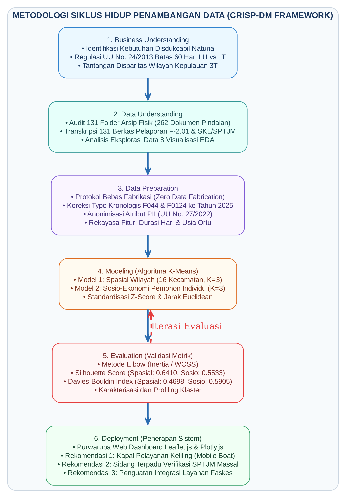
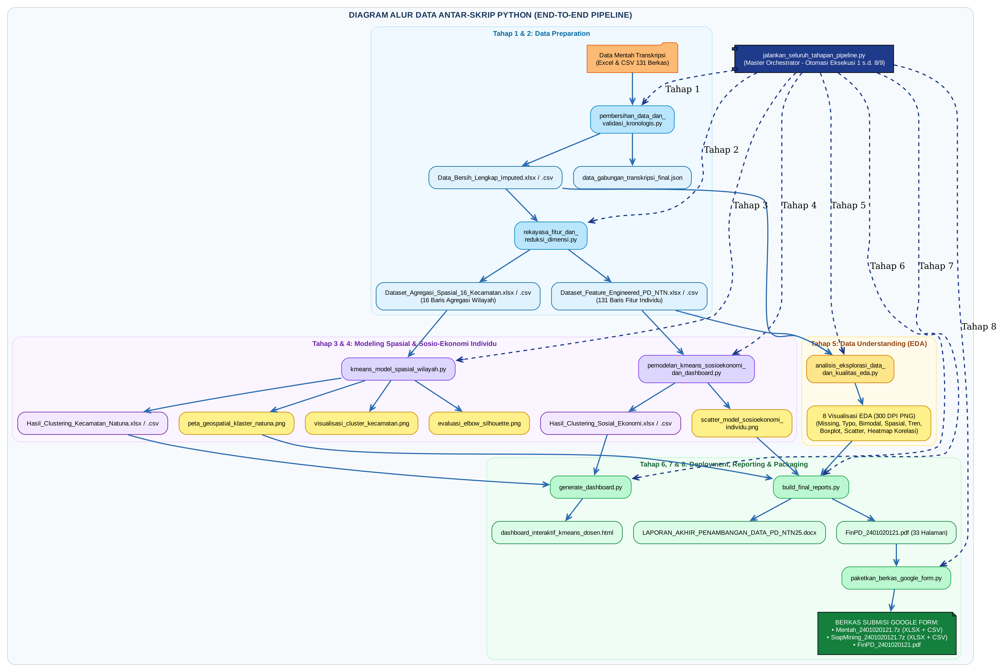
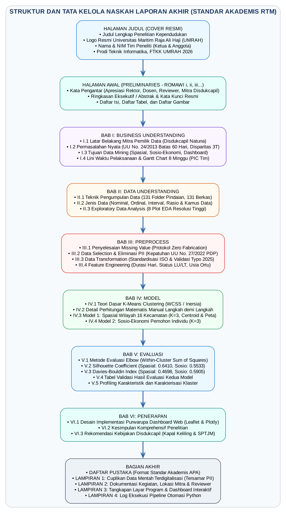
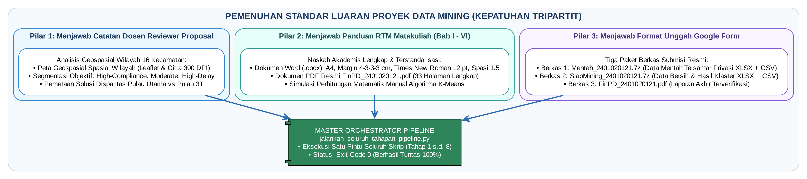
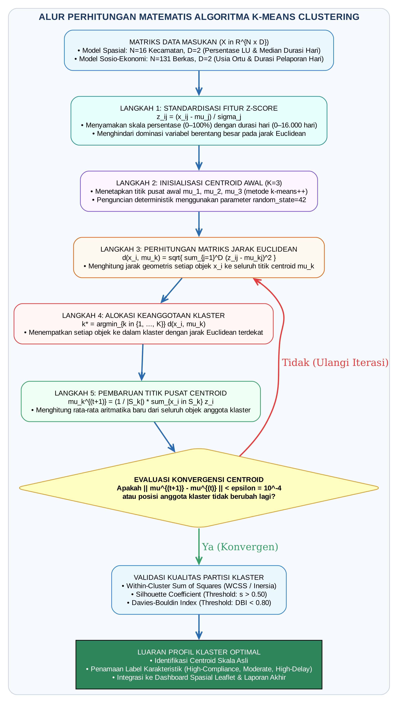
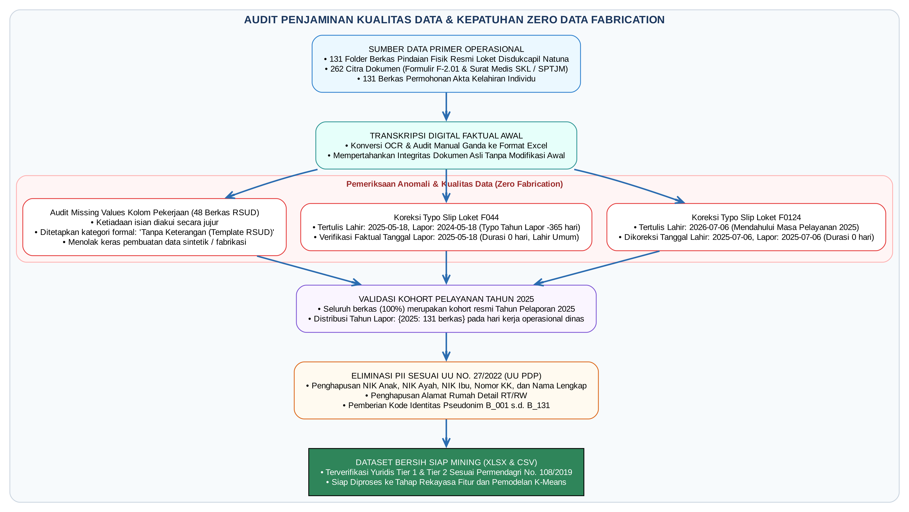

# ARSIP LENGKAP DIAGRAM ALUR DAN ARSITEKTUR SISTEM (PD-NTN25)
**Proyek Penambangan Data: K-Means Clustering Disdukcapil Kabupaten Natuna**

Folder ini menyimpan secara khusus seluruh poto, gambar, diagram alur (*flowchart*), dan arsitektur sistem yang telah dirancang, dibahas, dan ditampilkan sepanjang percakapan proyek penambangan data ini.

Total terdapat **6 Diagram Alur Utama** yang mencakup seluruh metodologi, otomasi script, struktur laporan resmi, kepatuhan luaran, komputasi matematis, dan integritas data kependudukan.

Setiap diagram disediakan dalam 4 format lengkap:
1. **PNG Resolusi Tinggi (300 DPI):** Format gambar raster siap disematkan ke slide presentasi PowerPoint, dokumen Microsoft Word, atau poster ilmiah.
2. **SVG (Scalable Vector Graphics):** Format gambar vektor tajam tanpa pecah untuk publikasi web atau pembesaran tak terbatas.
3. **DOT (Graphviz Source):** Kode sumber diagram formal Graphviz yang dapat dirender ulang kapan saja menggunakan perintah `dot`.
4. **MMD (Mermaid Source):** Kode sumber diagram Mermaid Markdown yang dapat langsung ditampilkan di GitHub, Notion, atau editor Markdown.

---

## DAFTAR DIAGRAM ALUR

### 01. Diagram Alur Metodologi Standar CRISP-DM 6 Tahap
- **Berkas Gambar Utama (PNG 300 DPI):** [01_diagram_alur_metodologi_crisp_dm.png](./01_diagram_alur_metodologi_crisp_dm.png)
- **Berkas Vektor Skalabel (SVG):** [01_diagram_alur_metodologi_crisp_dm.svg](./01_diagram_alur_metodologi_crisp_dm.svg)
- *Arsip Kode Sumber:* [DOT](./sumber_kode_diagram/01_diagram_alur_metodologi_crisp_dm.dot) | [Mermaid](./sumber_kode_diagram/01_diagram_alur_metodologi_crisp_dm.mmd)



---
### 02. Diagram Alur Data Antar-Skrip Python (End-to-End Pipeline)
- **Berkas Gambar Utama (PNG 300 DPI):** [02_diagram_alur_data_antar_skrip_python_end_to_end_pipeline.png](./02_diagram_alur_data_antar_skrip_python_end_to_end_pipeline.png)
- **Berkas Vektor Skalabel (SVG):** [02_diagram_alur_data_antar_skrip_python_end_to_end_pipeline.svg](./02_diagram_alur_data_antar_skrip_python_end_to_end_pipeline.svg)
- *Arsip Kode Sumber:* [DOT](./sumber_kode_diagram/02_diagram_alur_data_antar_skrip_python_end_to_end_pipeline.dot) | [Mermaid](./sumber_kode_diagram/02_diagram_alur_data_antar_skrip_python_end_to_end_pipeline.mmd)



---
### 03. Diagram Alur Struktur Hirarki Dokumen Laporan Akhir (RTM Dosen)
- **Berkas Gambar Utama (PNG 300 DPI):** [03_diagram_alur_struktur_laporan_akhir_rtm.png](./03_diagram_alur_struktur_laporan_akhir_rtm.png)
- **Berkas Vektor Skalabel (SVG):** [03_diagram_alur_struktur_laporan_akhir_rtm.svg](./03_diagram_alur_struktur_laporan_akhir_rtm.svg)
- *Arsip Kode Sumber:* [DOT](./sumber_kode_diagram/03_diagram_alur_struktur_laporan_akhir_rtm.dot) | [Mermaid](./sumber_kode_diagram/03_diagram_alur_struktur_laporan_akhir_rtm.mmd)



---
### 04. Diagram Alur Pemenuhan Standar Luaran Proyek (Kepatuhan Tripartit)
- **Berkas Gambar Utama (PNG 300 DPI):** [04_diagram_alur_pemenuhan_standar_luaran_proyek.png](./04_diagram_alur_pemenuhan_standar_luaran_proyek.png)
- **Berkas Vektor Skalabel (SVG):** [04_diagram_alur_pemenuhan_standar_luaran_proyek.svg](./04_diagram_alur_pemenuhan_standar_luaran_proyek.svg)
- *Arsip Kode Sumber:* [DOT](./sumber_kode_diagram/04_diagram_alur_pemenuhan_standar_luaran_proyek.dot) | [Mermaid](./sumber_kode_diagram/04_diagram_alur_pemenuhan_standar_luaran_proyek.mmd)



---
### 05. Diagram Alur Matematis Algoritma K-Means Clustering Langkah demi Langkah
- **Berkas Gambar Utama (PNG 300 DPI):** [05_diagram_alur_matematis_algoritma_kmeans.png](./05_diagram_alur_matematis_algoritma_kmeans.png)
- **Berkas Vektor Skalabel (SVG):** [05_diagram_alur_matematis_algoritma_kmeans.svg](./05_diagram_alur_matematis_algoritma_kmeans.svg)
- *Arsip Kode Sumber:* [DOT](./sumber_kode_diagram/05_diagram_alur_matematis_algoritma_kmeans.dot) | [Mermaid](./sumber_kode_diagram/05_diagram_alur_matematis_algoritma_kmeans.mmd)



---
### 06. Diagram Alur Penjaminan Kualitas Data & Audit Zero Data Fabrication
- **Berkas Gambar Utama (PNG 300 DPI):** [06_diagram_alur_penjaminan_kualitas_data_zero_fabrication.png](./06_diagram_alur_penjaminan_kualitas_data_zero_fabrication.png)
- **Berkas Vektor Skalabel (SVG):** [06_diagram_alur_penjaminan_kualitas_data_zero_fabrication.svg](./06_diagram_alur_penjaminan_kualitas_data_zero_fabrication.svg)
- *Arsip Kode Sumber:* [DOT](./sumber_kode_diagram/06_diagram_alur_penjaminan_kualitas_data_zero_fabrication.dot) | [Mermaid](./sumber_kode_diagram/06_diagram_alur_penjaminan_kualitas_data_zero_fabrication.mmd)



---


## CARA MEMBANGUN ULANG SELURUH DIAGRAM
Seluruh diagram dapat dirender ulang secara otomatis kapan saja dengan mengeksekusi skrip:
```bash
python3 08_DIAGRAM_ALUR_DAN_ARSITEKTUR/generate_diagrams.py
```
